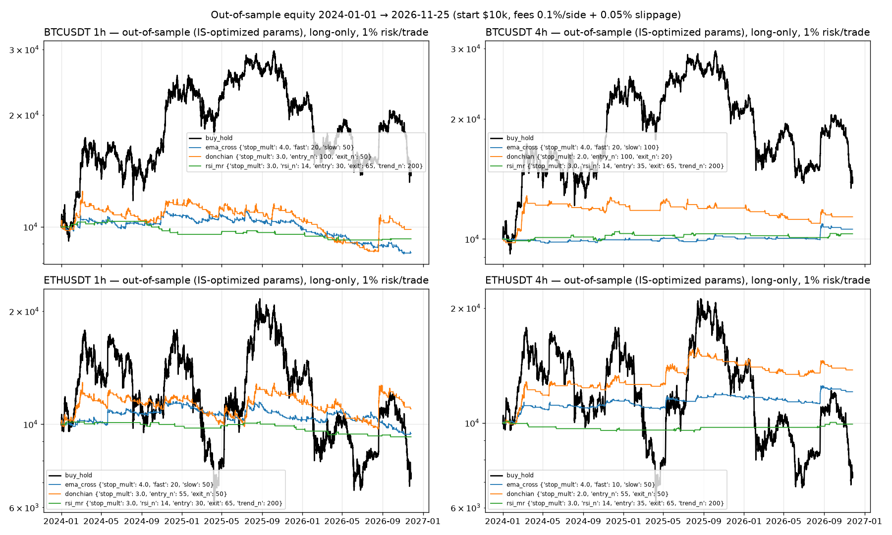

# binance-trading-bot

Research and a paper-trading bot for simple, rule-based crypto strategies on Binance (BTC/USDT, ETH/USDT).

> **Disclaimer: not financial advice.** This is experimental research code. Backtests are hypothetical and past performance does not predict future results. The bot is wired to the Binance **Spot Testnet** only (fake money). Trading real funds can lose all capital.

## Overview
- `tradebot/` – data download, strategies (EMA cross, Donchian breakout, RSI mean reversion), bar-by-bar backtester with fees, slippage, intrabar ATR stops and 1% risk sizing.
- `run_backtests.py` – in-sample grid optimisation (2020–2023), out-of-sample test (2024→today), walk-forward and grid-stability checks → `results.csv`, `grid_results.csv`, `oos_equity.png`.
- `paperbot/` – the chosen strategy (**Donchian 4h long-only**: ETH 55/50, BTC 100/20, 2 ATR stop) as a restart-safe paper-trading bot on the Binance Spot Testnet.
- **Research write-up, tables and findings: [RESEARCH.md](RESEARCH.md).**



## Quick start
```bash
python3 -m venv .venv && . .venv/bin/activate
pip install -r requirements.txt
python -m pytest -q tests          # unit tests on recorded data, no keys
python -m tradebot.data            # download Binance klines to data/ (no keys)
python run_backtests.py            # reproduce the research outputs
```

## Paper bot
Signals use closed 4h candles from Binance mainnet public data (testnet candles have fake wicks, see RESEARCH.md); orders go to the testnet. Risk: 1% per trade, one position per symbol, 3% daily loss cap, `state/PAUSE` and `state/KILL` files. Every signal/order/fill goes to `logs/journal-<mode>.csv` and `logs/bot-<mode>.log`; state persists in `state/state-<mode>.json` and is reconciled with exchange balances on startup. A hard guard refuses to run unless ccxt sandbox mode is on and endpoints are `testnet.binance.vision`.

```bash
python -m paperbot once --dry-run   # simulated broker, no keys
python -m paperbot run --dry-run
export BINANCE_TESTNET_API_KEY=... BINANCE_TESTNET_API_SECRET=...   # from https://testnet.binance.vision
python -m paperbot smoke            # auth + balances + signals; trades only on a real signal
python -m paperbot run              # 24/7 loop (wakes ~60s after 00/04/08/12/16/20 UTC, polls stops every 60s)
python -m paperbot status
python compare_backtest.py --mode testnet   # live paper results vs backtest replay/expectations
```

## Deploy (Oracle Cloud Ubuntu, 24/7)
See [deploy/DEPLOY.md](deploy/DEPLOY.md) and [deploy/trading-bot.service](deploy/trading-bot.service).

## Layout
```
tradebot/   data.py strategies.py indicators.py backtest.py
paperbot/   config.py engine.py broker.py market.py state.py journal.py __main__.py
tests/      test_paperbot.py fixtures/ETHUSDT_4h_2023-09_2024-12.csv
deploy/     DEPLOY.md trading-bot.service
data/       README.md (raw parquet not committed)
results.csv grid_results.csv oos_equity.png RESEARCH.md
```
