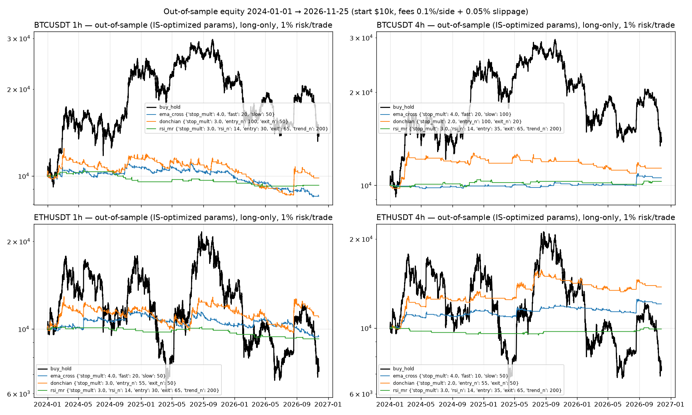

# Research: simple rule-based strategies on Binance BTC/ETH

> **Not financial advice.** Backtests are hypothetical, past performance does not predict future results, and trading crypto can lose all capital. Every number here was produced by `run_backtests.py` and is stored in `results.csv` / `grid_results.csv`.

## Data
- Binance **spot** OHLCV, BTCUSDT and ETHUSDT, 1h and 4h, 2020-01-01 → 2026-11-25 (monthly zips from data.binance.vision + public REST for the current month; `tradebot/data.py`).
- The 1h series has 15 small gaps from Binance outages; left unfilled.

## Method
- **Strategies** (`tradebot/strategies.py`), long-only spot unless noted:
  - `ema_cross` – EMA fast/slow crossover entry, exit on fast<slow or an ATR trailing stop.
  - `donchian` – turtle-style breakout: close above prior N-bar high; exit on close below prior M-bar low or a fixed ATR stop.
  - `rsi_mr` – RSI below threshold while close > 200 EMA; exit when RSI rises above exit level or ATR stop.
  - `buy_hold` – benchmark.
- **Realism** (`tradebot/backtest.py`): signals on closed candles, fills at next open; 0.1% fee per side + 0.05% adverse slippage per fill; stops checked intrabar against high/low, gap-throughs fill at the worse open; position size risks 1% of equity entry-to-stop, capped at 1x notional (no leverage).
- **Anti-curve-fitting**: parameters chosen by in-sample (IS, 2020-01 → 2023-12) daily-return Sharpe over a small grid (14–24 combos per strategy, min 20 trades); out-of-sample (OOS) = 2024-01-01 → 2026-11-25 with those params. Plus a rolling **walk-forward** (24-month train / 6-month test, re-optimised each step, stitched 2022-01 → now) and **grid-neighbourhood stability**.
- Sharpe is annualised from daily equity returns (√365). Exposure = share of bars in a position.
- `long_short` mode = same rules allowing shorts at 1x (proxy for futures); **funding and borrow costs are not modelled**.

## Out-of-sample results (2024-01 → 2026-11, long-only, IS-chosen params)
| Symbol | TF | Strategy | Mode | Params | CAGR | Total return | Max DD | Sharpe | Win rate | Profit factor | Trades | Exposure |
|---|---|---|---|---|---|---|---|---|---|---|---|---|
| BTCUSDT | 1h | buy_hold | long |  | 13.1% | 42.8% | -55.7% | 0.49 | – | – | 1 | 100.0% |
| BTCUSDT | 1h | ema_cross | long | {stop: 4.0, fast: 20, slow: 50} | -5.4% | -14.8% | -23.8% | -0.53 | 31.5% | 0.84 | 238 | 24.0% |
| BTCUSDT | 1h | donchian | long | {stop: 3.0, entry_n: 100, exit_n: 50} | -0.6% | -1.6% | -31.4% | 0.04 | 23.5% | 0.98 | 115 | 29.8% |
| BTCUSDT | 1h | rsi_mr | long | {stop: 3.0, rsi_n: 14, entry: 30, exit: 65, trend_n: 200} | -2.5% | -7.2% | -12.3% | -0.65 | 38.5% | 0.60 | 26 | 2.9% |
| BTCUSDT | 4h | buy_hold | long |  | 13.1% | 42.8% | -54.8% | 0.49 | – | – | 1 | 100.0% |
| BTCUSDT | 4h | ema_cross | long | {stop: 4.0, fast: 20, slow: 100} | 2.0% | 5.8% | -3.4% | 0.46 | 38.9% | 1.53 | 36 | 16.7% |
| BTCUSDT | 4h | donchian | long | {stop: 2.0, entry_n: 100, exit_n: 20} | 4.5% | 13.7% | -14.8% | 0.50 | 27.9% | 1.35 | 43 | 19.7% |
| BTCUSDT | 4h | rsi_mr | long | {stop: 3.0, rsi_n: 14, entry: 35, exit: 65, trend_n: 200} | 1.0% | 3.0% | -4.1% | 0.32 | 52.4% | 1.28 | 21 | 10.5% |
| ETHUSDT | 1h | buy_hold | long |  | -9.8% | -25.9% | -69.1% | 0.18 | – | – | 1 | 100.0% |
| ETHUSDT | 1h | ema_cross | long | {stop: 4.0, fast: 20, slow: 50} | -2.0% | -5.6% | -18.4% | -0.14 | 32.7% | 0.94 | 257 | 25.9% |
| ETHUSDT | 1h | donchian | long | {stop: 3.0, entry_n: 55, exit_n: 50} | 3.3% | 9.9% | -25.0% | 0.26 | 24.0% | 1.08 | 146 | 38.8% |
| ETHUSDT | 1h | rsi_mr | long | {stop: 3.0, rsi_n: 14, entry: 30, exit: 65, trend_n: 200} | -2.6% | -7.4% | -9.1% | -0.78 | 36.0% | 0.57 | 25 | 2.5% |
| ETHUSDT | 4h | buy_hold | long |  | -9.8% | -25.9% | -68.0% | 0.18 | – | – | 1 | 100.0% |
| ETHUSDT | 4h | ema_cross | long | {stop: 4.0, fast: 10, slow: 50} | 6.7% | 20.7% | -6.3% | 0.90 | 29.1% | 1.68 | 86 | 31.2% |
| ETHUSDT | 4h | donchian | long | {stop: 2.0, entry_n: 55, exit_n: 50} | 11.6% | 37.7% | -15.8% | 0.96 | 24.3% | 2.01 | 37 | 34.2% |
| ETHUSDT | 4h | rsi_mr | long | {stop: 3.0, rsi_n: 14, entry: 35, exit: 65, trend_n: 200} | -0.3% | -0.8% | -6.5% | -0.09 | 47.1% | 0.92 | 17 | 5.8% |

## Long-only vs long/short (OOS, all timeframes)
| Symbol | TF | Strategy | Mode | Params | CAGR | Total return | Max DD | Sharpe | Win rate | Profit factor | Trades | Exposure |
|---|---|---|---|---|---|---|---|---|---|---|---|---|
| BTCUSDT | 1h | buy_hold | long |  | 13.1% | 42.8% | -55.7% | 0.49 | – | – | 1 | 100.0% |
| BTCUSDT | 1h | ema_cross | long | {stop: 4.0, fast: 20, slow: 50} | -5.4% | -14.8% | -23.8% | -0.53 | 31.5% | 0.84 | 238 | 24.0% |
| BTCUSDT | 1h | ema_cross | long_short | {stop: 4.0, fast: 20, slow: 100} | -9.9% | -26.2% | -36.6% | -1.05 | 29.7% | 0.75 | 296 | 31.6% |
| BTCUSDT | 1h | donchian | long | {stop: 3.0, entry_n: 100, exit_n: 50} | -0.6% | -1.6% | -31.4% | 0.04 | 23.5% | 0.98 | 115 | 29.8% |
| BTCUSDT | 1h | donchian | long_short | {stop: 3.0, entry_n: 100, exit_n: 50} | -9.6% | -25.4% | -45.5% | -0.41 | 24.7% | 0.83 | 215 | 55.0% |
| BTCUSDT | 1h | rsi_mr | long | {stop: 3.0, rsi_n: 14, entry: 30, exit: 65, trend_n: 200} | -2.5% | -7.2% | -12.3% | -0.65 | 38.5% | 0.60 | 26 | 2.9% |
| BTCUSDT | 1h | rsi_mr | long_short | {stop: 3.0, rsi_n: 14, entry: 30, exit: 65, trend_n: 200} | -4.2% | -11.6% | -16.5% | -0.91 | 37.5% | 0.57 | 40 | 4.1% |
| BTCUSDT | 4h | buy_hold | long |  | 13.1% | 42.8% | -54.8% | 0.49 | – | – | 1 | 100.0% |
| BTCUSDT | 4h | ema_cross | long | {stop: 4.0, fast: 20, slow: 100} | 2.0% | 5.8% | -3.4% | 0.46 | 38.9% | 1.53 | 36 | 16.7% |
| BTCUSDT | 4h | ema_cross | long_short | {stop: 4.0, fast: 20, slow: 100} | -0.3% | -1.0% | -6.4% | -0.04 | 33.8% | 0.95 | 65 | 29.3% |
| BTCUSDT | 4h | donchian | long | {stop: 2.0, entry_n: 100, exit_n: 20} | 4.5% | 13.7% | -14.8% | 0.50 | 27.9% | 1.35 | 43 | 19.7% |
| BTCUSDT | 4h | donchian | long_short | {stop: 2.0, entry_n: 100, exit_n: 20} | 3.0% | 9.0% | -23.4% | 0.30 | 25.3% | 1.13 | 79 | 34.4% |
| BTCUSDT | 4h | rsi_mr | long | {stop: 3.0, rsi_n: 14, entry: 35, exit: 65, trend_n: 200} | 1.0% | 3.0% | -4.1% | 0.32 | 52.4% | 1.28 | 21 | 10.5% |
| BTCUSDT | 4h | rsi_mr | long_short | {stop: 3.0, rsi_n: 14, entry: 30, exit: 65, trend_n: 200} | 1.9% | 5.5% | -3.0% | 0.76 | 66.7% | 2.23 | 12 | 6.4% |
| ETHUSDT | 1h | buy_hold | long |  | -9.8% | -25.9% | -69.1% | 0.18 | – | – | 1 | 100.0% |
| ETHUSDT | 1h | ema_cross | long | {stop: 4.0, fast: 20, slow: 50} | -2.0% | -5.6% | -18.4% | -0.14 | 32.7% | 0.94 | 257 | 25.9% |
| ETHUSDT | 1h | ema_cross | long_short | {stop: 4.0, fast: 20, slow: 50} | -8.0% | -21.5% | -25.6% | -0.60 | 30.5% | 0.85 | 436 | 42.6% |
| ETHUSDT | 1h | donchian | long | {stop: 3.0, entry_n: 55, exit_n: 50} | 3.3% | 9.9% | -25.0% | 0.26 | 24.0% | 1.08 | 146 | 38.8% |
| ETHUSDT | 1h | donchian | long_short | {stop: 3.0, entry_n: 55, exit_n: 50} | 10.9% | 34.9% | -24.2% | 0.55 | 27.2% | 1.17 | 250 | 73.9% |
| ETHUSDT | 1h | rsi_mr | long | {stop: 3.0, rsi_n: 14, entry: 30, exit: 65, trend_n: 200} | -2.6% | -7.4% | -9.1% | -0.78 | 36.0% | 0.57 | 25 | 2.5% |
| ETHUSDT | 1h | rsi_mr | long_short | {stop: 2.0, rsi_n: 14, entry: 35, exit: 65, trend_n: 200} | -6.4% | -17.3% | -25.1% | -0.60 | 35.3% | 0.83 | 139 | 12.1% |
| ETHUSDT | 4h | buy_hold | long |  | -9.8% | -25.9% | -68.0% | 0.18 | – | – | 1 | 100.0% |
| ETHUSDT | 4h | ema_cross | long | {stop: 4.0, fast: 10, slow: 50} | 6.7% | 20.7% | -6.3% | 0.90 | 29.1% | 1.68 | 86 | 31.2% |
| ETHUSDT | 4h | ema_cross | long_short | {stop: 4.0, fast: 10, slow: 50} | 1.1% | 3.1% | -9.0% | 0.18 | 30.3% | 1.08 | 132 | 44.5% |
| ETHUSDT | 4h | donchian | long | {stop: 2.0, entry_n: 55, exit_n: 50} | 11.6% | 37.7% | -15.8% | 0.96 | 24.3% | 2.01 | 37 | 34.2% |
| ETHUSDT | 4h | donchian | long_short | {stop: 2.0, entry_n: 55, exit_n: 50} | 19.7% | 68.3% | -13.7% | 1.24 | 25.4% | 2.05 | 67 | 68.1% |
| ETHUSDT | 4h | rsi_mr | long | {stop: 3.0, rsi_n: 14, entry: 35, exit: 65, trend_n: 200} | -0.3% | -0.8% | -6.5% | -0.09 | 47.1% | 0.92 | 17 | 5.8% |
| ETHUSDT | 4h | rsi_mr | long_short | {stop: 3.0, rsi_n: 14, entry: 35, exit: 65, trend_n: 200} | 0.8% | 2.2% | -4.4% | 0.20 | 47.5% | 1.10 | 40 | 12.7% |

## Walk-forward (24m train / 6m test, stitched 2022-01 → now)
| Symbol | TF | Strategy | Mode | Params | CAGR | Total return | Max DD | Sharpe | Win rate | Profit factor | Trades | Exposure |
|---|---|---|---|---|---|---|---|---|---|---|---|---|
| BTCUSDT | 1h | buy_hold | long |  | 5.6% | 30.6% | -67.4% | 0.36 | – | – | 1 | 100.0% |
| BTCUSDT | 1h | ema_cross | long |  | -6.4% | -27.6% | -29.0% | -0.81 | 27.8% | 0.72 | 295 | 15.5% |
| BTCUSDT | 1h | ema_cross | long_short |  | -11.9% | -46.3% | -47.0% | -1.35 | 27.3% | 0.65 | 450 | 25.3% |
| BTCUSDT | 1h | donchian | long |  | 4.2% | 22.4% | -33.5% | 0.32 | 22.0% | 1.19 | 200 | 27.4% |
| BTCUSDT | 1h | donchian | long_short |  | -1.4% | -6.8% | -43.9% | 0.04 | 25.1% | 1.01 | 378 | 47.5% |
| BTCUSDT | 1h | rsi_mr | long |  | -7.5% | -31.6% | -31.6% | -1.12 | 37.4% | 0.62 | 139 | 6.3% |
| BTCUSDT | 1h | rsi_mr | long_short |  | -7.0% | -29.8% | -31.4% | -1.09 | 36.4% | 0.61 | 129 | 6.1% |
| BTCUSDT | 4h | buy_hold | long |  | 5.6% | 30.6% | -67.2% | 0.36 | – | – | 1 | 100.0% |
| BTCUSDT | 4h | ema_cross | long |  | 4.7% | 25.0% | -6.3% | 0.81 | 34.6% | 1.89 | 81 | 17.1% |
| BTCUSDT | 4h | ema_cross | long_short |  | 1.8% | 9.4% | -14.1% | 0.38 | 32.6% | 1.31 | 92 | 23.6% |
| BTCUSDT | 4h | donchian | long |  | 5.5% | 30.0% | -13.3% | 0.61 | 29.2% | 1.66 | 72 | 25.8% |
| BTCUSDT | 4h | donchian | long_short |  | 9.3% | 54.6% | -29.4% | 0.75 | 26.4% | 1.55 | 129 | 49.4% |
| BTCUSDT | 4h | rsi_mr | long |  | -1.3% | -6.4% | -10.7% | -0.32 | 60.2% | 0.85 | 103 | 13.8% |
| BTCUSDT | 4h | rsi_mr | long_short |  | -0.2% | -1.1% | -12.7% | -0.03 | 53.6% | 0.98 | 84 | 14.4% |
| ETHUSDT | 1h | buy_hold | long |  | -14.7% | -54.0% | -76.7% | 0.11 | – | – | 1 | 100.0% |
| ETHUSDT | 1h | ema_cross | long |  | -3.4% | -15.7% | -22.2% | -0.42 | 32.7% | 0.84 | 303 | 15.7% |
| ETHUSDT | 1h | ema_cross | long_short |  | -2.8% | -13.0% | -30.3% | -0.23 | 32.7% | 0.94 | 490 | 24.3% |
| ETHUSDT | 1h | donchian | long |  | 0.8% | 4.1% | -27.0% | 0.13 | 23.8% | 1.06 | 248 | 29.2% |
| ETHUSDT | 1h | donchian | long_short |  | 5.8% | 31.8% | -37.6% | 0.34 | 23.9% | 1.09 | 418 | 56.0% |
| ETHUSDT | 1h | rsi_mr | long |  | -6.5% | -27.9% | -31.0% | -1.01 | 47.2% | 0.64 | 161 | 6.0% |
| ETHUSDT | 1h | rsi_mr | long_short |  | -4.1% | -18.5% | -25.8% | -0.55 | 47.7% | 0.80 | 197 | 7.4% |
| ETHUSDT | 4h | buy_hold | long |  | -14.7% | -54.0% | -76.2% | 0.11 | – | – | 1 | 100.0% |
| ETHUSDT | 4h | ema_cross | long |  | 2.8% | 14.3% | -7.5% | 0.53 | 33.6% | 1.41 | 107 | 21.5% |
| ETHUSDT | 4h | ema_cross | long_short |  | -2.3% | -10.9% | -19.8% | -0.38 | 29.2% | 0.83 | 154 | 24.9% |
| ETHUSDT | 4h | donchian | long |  | 7.7% | 43.7% | -9.6% | 0.81 | 33.3% | 2.00 | 57 | 24.8% |
| ETHUSDT | 4h | donchian | long_short |  | 10.1% | 60.1% | -22.3% | 0.79 | 30.1% | 1.71 | 103 | 44.3% |
| ETHUSDT | 4h | rsi_mr | long |  | -1.7% | -8.0% | -16.4% | -0.34 | 56.1% | 0.83 | 98 | 9.5% |
| ETHUSDT | 4h | rsi_mr | long_short |  | 1.0% | 5.1% | -7.9% | 0.20 | 52.5% | 1.09 | 122 | 13.7% |

## Parameter-neighbourhood / grid stability (OOS)
Neighbours = grid points one step away on one parameter from the chosen setting.
| Symbol | TF | Strategy | Mode | Neighbour IS Sharpe (mean) | Neighbour OOS Sharpe (mean) | Grid OOS Sharpe (median) | Grid share profitable OOS |
|---|---|---|---|---|---|---|---|
| BTCUSDT | 1h | ema_cross | long | -0.42 | -0.66 | -1.12 | 0.0% |
| BTCUSDT | 1h | ema_cross | long_short | -0.59 | -1.21 | -1.68 | 0.0% |
| BTCUSDT | 1h | donchian | long | 1.01 | 0.09 | -0.31 | 14.3% |
| BTCUSDT | 1h | donchian | long_short | 0.59 | -0.27 | -0.42 | 0.0% |
| BTCUSDT | 1h | rsi_mr | long | -0.69 | -0.69 | -0.95 | 4.2% |
| BTCUSDT | 1h | rsi_mr | long_short | -0.85 | -0.93 | -1.18 | 0.0% |
| BTCUSDT | 4h | ema_cross | long | 1.09 | 0.69 | 0.58 | 83.3% |
| BTCUSDT | 4h | ema_cross | long_short | 0.90 | 0.25 | 0.18 | 66.7% |
| BTCUSDT | 4h | donchian | long | 1.56 | 0.51 | 0.49 | 100.0% |
| BTCUSDT | 4h | donchian | long_short | 1.46 | 0.37 | 0.29 | 92.9% |
| BTCUSDT | 4h | rsi_mr | long | 0.57 | -0.13 | -0.51 | 16.7% |
| BTCUSDT | 4h | rsi_mr | long_short | 0.52 | 0.24 | -0.00 | 33.3% |
| ETHUSDT | 1h | ema_cross | long | 0.44 | -0.53 | -0.43 | 12.5% |
| ETHUSDT | 1h | ema_cross | long_short | -0.25 | -0.95 | -0.62 | 16.7% |
| ETHUSDT | 1h | donchian | long | 1.12 | 0.20 | 0.11 | 50.0% |
| ETHUSDT | 1h | donchian | long_short | 0.72 | 0.33 | 0.21 | 64.3% |
| ETHUSDT | 1h | rsi_mr | long | -0.32 | -0.94 | -1.10 | 0.0% |
| ETHUSDT | 1h | rsi_mr | long_short | -1.16 | -1.17 | -1.09 | 4.2% |
| ETHUSDT | 4h | ema_cross | long | 1.19 | 0.79 | 0.67 | 83.3% |
| ETHUSDT | 4h | ema_cross | long_short | 0.72 | 0.77 | 0.33 | 79.2% |
| ETHUSDT | 4h | donchian | long | 1.12 | 0.96 | 1.04 | 100.0% |
| ETHUSDT | 4h | donchian | long_short | 0.81 | 1.09 | 1.08 | 100.0% |
| ETHUSDT | 4h | rsi_mr | long | 0.03 | -0.29 | -0.42 | 16.7% |
| ETHUSDT | 4h | rsi_mr | long_short | -0.06 | -0.01 | -0.00 | 45.8% |

## In-sample (2020-01 → 2023-12) with chosen params
| Symbol | TF | Strategy | Mode | Params | CAGR | Total return | Max DD | Sharpe | Win rate | Profit factor | Trades | Exposure |
|---|---|---|---|---|---|---|---|---|---|---|---|---|
| BTCUSDT | 1h | buy_hold | long |  | 55.6% | 486.8% | -77.2% | 1.00 | – | – | 1 | 100.0% |
| BTCUSDT | 1h | ema_cross | long | {stop: 4.0, fast: 20, slow: 50} | -0.3% | -1.1% | -22.3% | 0.02 | 29.4% | 0.99 | 316 | 25.1% |
| BTCUSDT | 1h | donchian | long | {stop: 3.0, entry_n: 100, exit_n: 50} | 26.9% | 159.3% | -19.5% | 1.35 | 31.7% | 2.08 | 123 | 32.8% |
| BTCUSDT | 1h | rsi_mr | long | {stop: 3.0, rsi_n: 14, entry: 30, exit: 65, trend_n: 200} | -0.9% | -3.7% | -12.2% | -0.29 | 41.9% | 0.81 | 31 | 2.4% |
| BTCUSDT | 4h | buy_hold | long |  | 55.6% | 486.8% | -77.0% | 1.00 | – | – | 1 | 100.0% |
| BTCUSDT | 4h | ema_cross | long | {stop: 4.0, fast: 20, slow: 100} | 7.2% | 32.1% | -5.6% | 1.23 | 38.0% | 2.71 | 50 | 19.8% |
| BTCUSDT | 4h | donchian | long | {stop: 2.0, entry_n: 100, exit_n: 20} | 25.8% | 150.3% | -12.2% | 1.66 | 35.0% | 4.24 | 40 | 24.2% |
| BTCUSDT | 4h | rsi_mr | long | {stop: 3.0, rsi_n: 14, entry: 35, exit: 65, trend_n: 200} | 2.3% | 9.6% | -6.3% | 0.75 | 66.7% | 2.05 | 27 | 10.6% |
| ETHUSDT | 1h | buy_hold | long |  | 104.9% | 1664.1% | -81.3% | 1.26 | – | – | 1 | 100.0% |
| ETHUSDT | 1h | ema_cross | long | {stop: 4.0, fast: 20, slow: 50} | 7.4% | 32.9% | -14.7% | 0.76 | 37.0% | 1.27 | 305 | 26.3% |
| ETHUSDT | 1h | donchian | long | {stop: 3.0, entry_n: 55, exit_n: 50} | 30.4% | 189.4% | -22.3% | 1.34 | 31.4% | 1.60 | 191 | 45.3% |
| ETHUSDT | 1h | rsi_mr | long | {stop: 3.0, rsi_n: 14, entry: 30, exit: 65, trend_n: 200} | 0.4% | 1.6% | -4.7% | 0.13 | 48.6% | 1.09 | 35 | 3.1% |
| ETHUSDT | 4h | buy_hold | long |  | 105.0% | 1664.1% | -81.1% | 1.26 | – | – | 1 | 100.0% |
| ETHUSDT | 4h | ema_cross | long | {stop: 4.0, fast: 10, slow: 50} | 11.0% | 51.8% | -6.0% | 1.47 | 41.1% | 2.35 | 112 | 36.2% |
| ETHUSDT | 4h | donchian | long | {stop: 2.0, entry_n: 55, exit_n: 50} | 24.0% | 136.2% | -11.2% | 1.32 | 33.3% | 3.10 | 51 | 47.8% |
| ETHUSDT | 4h | rsi_mr | long | {stop: 3.0, rsi_n: 14, entry: 35, exit: 65, trend_n: 200} | 2.1% | 8.8% | -5.9% | 0.69 | 61.3% | 1.68 | 31 | 10.6% |

## Findings
- **Donchian 4h long-only is the only family that held up everywhere**: positive OOS on both coins, every grid setting profitable OOS on both coins (grid share profitable 100%), and walk-forward Sharpe above buy-and-hold (BTC 0.61 vs 0.36; ETH 0.81 vs 0.11).
- **ETH 4h Donchian (55/50, 2 ATR)**: OOS +37.7%, max DD −15.8%, Sharpe 0.96 vs buy-and-hold −25.9%, −68.0%, 0.18.
- **BTC 4h Donchian (100/20, 2 ATR)**: OOS +13.7%, max DD −14.8%, Sharpe 0.50 vs buy-and-hold +42.8%, −54.8%, 0.49 – about equal risk-adjusted, far less return, far smaller drawdown. **Nothing beat BTC buy-and-hold on OOS Sharpe by a meaningful margin.**
- **1h versions lose to fees**; most 1h variants were negative OOS.
- **RSI mean reversion failed OOS** (Sharpe ~0 or negative) despite positive IS results.
- **Long/short** is mixed: it helped ETH Donchian (4h OOS Sharpe 1.24, +68.3%) but hurt BTC Donchian and EMA crossovers; funding costs would reduce it further. Not adopted.
- Side check (not in results.csv; one-off run): delaying every signal one extra bar left ETH 4h Donchian OOS Sharpe at 0.86 and BTC at 0.77, so results are not driven by look-ahead. Scaling risk to 2% per trade roughly doubled ETH 4h OOS return (+77.7%) with max DD −29.0% and the same Sharpe (0.96).

## Testnet finding (paper bot)
Binance Spot Testnet 4h closes tracked mainnet within ~0.2% over the last 200 candles, but testnet highs/lows had fake wicks (max 4h range 35.7% BTC / 30.0% ETH vs 6.4% / 8.4% on mainnet). Those would corrupt Donchian channels and trigger stops falsely, so the paper bot computes signals and checks stops on **mainnet public candles** and only sends orders to the testnet.

## Caveats
- OOS is ~2.9 years and ~37–43 trades per symbol: a small sample. Win rates are 24–28% – expect long losing streaks (most exits are stop-outs).
- ETH's OOS period was a bear market for buy-and-hold, which flatters a trend system with stops; in a strong bull market these strategies lag buy-and-hold.
- At 1% risk the strategies hold only ~9–11% of capital on average, so absolute returns are modest.
- Not modelled: order-book depth, partial fills, exchange outages, taxes, futures funding.

## Recommendation
Paper-trade **Donchian 4h long-only** on ETH/USDT (55/50, 2 ATR) and BTC/USDT (100/20, 2 ATR) at 1% risk on the Binance Spot Testnet (see `paperbot/`), and compare live results to the backtest with `compare_backtest.py` for several weeks before considering real money.

